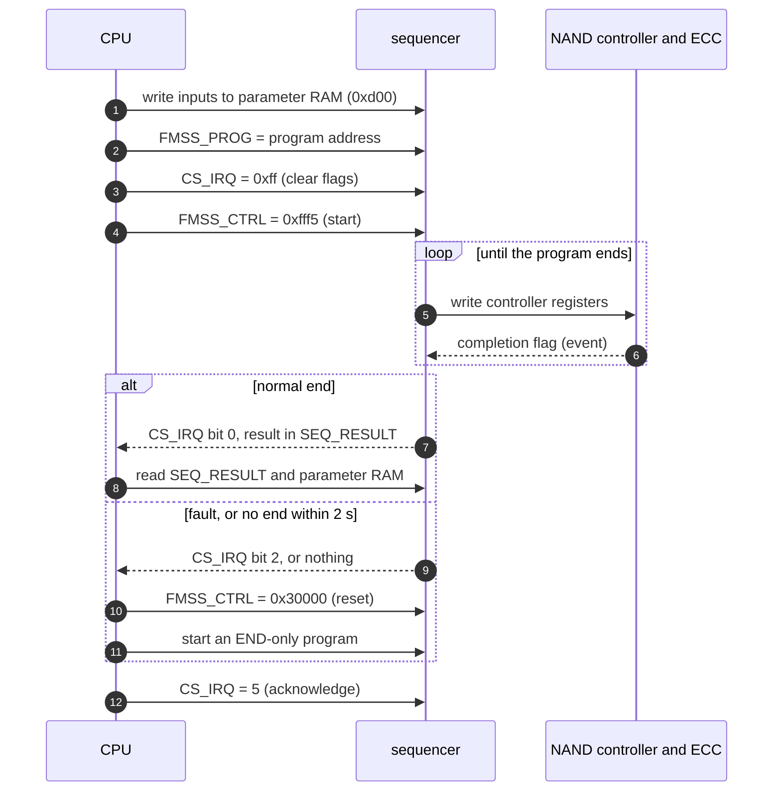
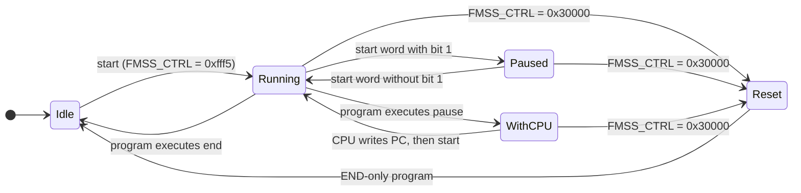

# Chapter 2 — Architecture: execution model, start, stop and fault handling

Summary: How the sequencer runs a program, how the CPU starts, pauses, holds, resets and ends a run, and what happens when a program ends and when a fault occurs. The three blocks (sequencer, NAND controller (FMC), ECC engine) are described in [chapter 1, section 1.4](01-overview.md#14-the-three-blocks).

## 2.1 How the sequencer is started and stopped

**Two NAND controller registers look like start and stop switches, but they are not part of the sequencer:**

- `FMC_CTRL0` (`0x000`) is the NAND controller's configuration word: controller enable (bit 0), chip selection (bits 8:1), bus timings, and DMA enable (bit 24) ([chapter 9, section 9.1](09-nand-controller.md#91-fmc_ctrl0-0x000-nand-controller-configuration-not-a-sequencer-control)). Programs write it at their start. To switch chips they modify it in three steps: `ld` with a mask that keeps everything except the chip bits, `or` in the new chip, and `st`. It does not start or stop anything. The CPU writes 0 to it at start-up and at power-off, so that no chip is selected.
- `FMCTRL1` (`0x004`) is the NAND controller's "go" register. Each write starts one operation (sending the address bytes, reading or writing data, latching the status byte, or a DMA), and a flag in `FMC_STATUS` shows when the operation is done ([chapter 9, section 9.2](09-nand-controller.md#92-fmctrl1-0x004-nand-controller-operation-trigger-not-a-sequencer-control), [chapter 9, section 9.4](09-nand-controller.md#94-fmc_status-bits)).

**Starting the sequencer** (done by the CPU; [chapter 3, section 3.5](03-cpu-memory-map.md#35-starting-and-finishing-a-run), [chapter 8, section 8.1](08-sequencer-control-registers.md#81-sequencer-control-block)):

1. The parameters are already in parameter RAM (`0xd00..`) and the program is already in system memory.
2. `FMSS_PROG` (`0xc04`) = the program's bus address; `CS_IRQ` (`0xc0c`) = `0xff` (this clears the flags).
3. `FMSS_CTRL` (`0xc00`) = `0xfff5`. Bit 0 starts the program at its first instruction, and r0..r7 keep the values the CPU wrote. After a sequencer reset, the first start only primes the sequencer ([`startseq3`](14-evidence.md#14235-startseq3-run-8); [C13](11-nand-operations.md#11113-c13-prime-after-a-reset-cpu-side)).

**Stopping**:

- normally: the program executes `end`. `CS_IRQ` bit 0 is set, the value of r6 appears in `SEQ_RESULT` (`0xc30`), and the sequencer stays idle until the next start (`FMSS_CTRL` bit 18 is clear).
- by a fault: a `wait` (or `wait2`, `evjmp`) that times out, or an illegal opcode, sets `CS_IRQ` bit 2. The sequencer then continues at the fault handler (address in `C4C`) or at the next instruction, as `C58` selects ([chapter 2, section 2.3](#23-end-and-fault)). The program must still reach an `end`.
- by the CPU: writing `FMSS_CTRL` = `0x30000` resets the sequencer, whatever it is doing. The reset clears r0..r7, `C08`, `C40` and `C44`, and keeps `C58`, `C4C` and `C5C`. The original CPU driver does this after a fault or after 2 s without an END ([RE-33](14-evidence.md#14333-re-33-cpu-driver-reset), [RE-32](14-evidence.md#14332-re-32-cpu-driver-wait-and-classify)).
- handed to the CPU by the program: `pause` (opcode `12`) stops the program and sets `CS_IRQ` bit 3. The CPU then writes the PC (`0xc38`; normally the offset of the `pause` instruction + 8) and a start word, and the program continues at that PC ([chapter 6, opcode `12`](06-opcode-reference.md#12-pause)).
- paused, not stopped: while the program runs, a start word written with bit 1 set freezes it where it is, and a start word written without bit 1 continues it. A start word with bit 3 or bit 16 set, written while the program runs, aborts the program and returns the sequencer to the hold state that follows a reset ([chapter 8, section 8.1.1](08-sequencer-control-registers.md#811-start-word-and-timeout-fmss_ctrl-device)).

The CPU can observe a run through four registers:

- `CS_IRQ`: bit 0 reports END and bit 2 reports a fault.
- `FMSS_CTRL` bit 18: set when the program has started and not yet finished.
- `C08`: a state code (running, waiting, paused, stopped at `pause`).
- the PC (`0xc38`).

**One run, as seen at the interface between the CPU and the sequencer** (what happens inside the program is described from [chapter 2, section 2.2](#22-execution-model) onwards):

**The sequencer's states as the CPU controls them** (details in "Stopping" above and [chapter 8, section 8.1](08-sequencer-control-registers.md#81-sequencer-control-block); after a reset the first start only primes the sequencer; "WithCPU" is the state of a program stopped at `pause`, with `CS_IRQ` bit 3 set):

## 2.2 Execution model

- The sequencer is a small processor inside the NAND controller. It fetches 8-byte instructions from system memory, starting at the bus address in `FMSS_PROG` (8-byte aligned). The original CPU driver performs no cache maintenance around a run ([RE-44](14-evidence.md#14344-re-44-no-cache-maintenance-in-the-cpu-side-driver)).
- The sequencer has eight 32-bit registers, r0..r7. The CPU can read them at controller offsets `0xc18 + 4*n`. After END, r6 (`0xc30`) serves as the program's result word (`SEQ_RESULT`). The sequencer has no flags or condition codes; a branch tests the value of a register.
- The program counter (`FMSS_PC`, `0xc38`) is a byte offset from the start of the program. Branch targets and the fault vector are also byte offsets; the original programs keep them multiples of 8. There are no delay slots.
- Register-access instructions address the controller's register window with a 12-bit byte offset from the controller base address: `0x000..` NAND controller, `0x800..` ECC engine, `0xc00..` sequencer control, `0xd00..` parameter RAM ([chapter 3, section 3.2](03-cpu-memory-map.md#32-memory-map-the-register-window)).
- The memory-access instructions (`ldi`, `sti`) use a 32-bit bus address held in a register, rounded down to a multiple of 4. Their accesses are not kept coherent with the CPU data cache.
- No cycle count per instruction is specified. The measured time per instruction is determined by the instruction fetch: 217 ns when the program is in SDRAM and 138 ns when it is in internal SRAM ([chapter 5, section 5.3](05-instruction-encoding.md#53-opcodes)).
- A program ends only with `end` (the all-zero instruction) or through a `wait` timeout that jumps to the fault handler. A program without an `end` runs on into whatever follows it in memory; zeroed memory reads as `end`.

## 2.3 END and fault

- Normal end: the program executes `end`. The sequencer sets `CS_IRQ` bit 0 and presents the value of r6 in `SEQ_RESULT` (`0xc30`). The original CPU driver polls VIC1 raw status bit 22 (interrupt source 54) to detect the end ([RE-32](14-evidence.md#14332-re-32-cpu-driver-wait-and-classify)). In the device tests, that VIC1 bit stayed clear after END, after a fault and with any start word ([`irqline`, device run 15](14-evidence.md#14267-irqline-run-15), [`irqline`, device run 16](14-evidence.md#14270-irqline-run-16), [`irqline`, device run 17](14-evidence.md#14276-irqline-run-17), [`irqen`, device run 16](14-evidence.md#14271-irqen-run-16), [`irqen`, device run 17](14-evidence.md#14277-irqen-run-17)); when a NAND controller or ECC interrupt enable was set, the only effect was that `CS_IRQ` bits 4 and 6 were set. Whether a further enable outside the sequencer block, which the original firmware sets, is needed for the VIC1 bit is open ([chapter 17, section 17.3](17-open-questions.md#173-interrupts)). `CS_IRQ` bits 0 and 2 report the end and the fault.
- Fault: a `wait` timeout, or an opcode without a defined meaning (which first stalls for the same time, about 4.87 ms), sets `CS_IRQ` bit 2 and, with `C58` bit 2 set, jumps to the fault vector (device). The handler ends with `end`, so `CS_IRQ` bit 0 is also set. The original handlers test `FMSS_C50` bit 0 and write 1 to acknowledge it. On the device, `FMSS_C50` bit 0 is set while a command flag is pending and clear otherwise; a timeout or an illegal opcode does not change it, and the handler's write of 1 does not clear it ([`c50fault`](14-evidence.md#142138-c50fault-run-35)). A PROGRAM or ERASE handler entered by a timeout with no command flag pending therefore returns the failure bit 28 without bit 27 (inferred from the handler code, [RE-25](14-evidence.md#14325-re-25-fault-handlers), and this device result). The READ, READID and RAWREAD handlers set bit 27 unconditionally. The original CPU driver treats `CS_IRQ` bit 2 set as a failed run and then resets the sequencer ([RE-32](14-evidence.md#14332-re-32-cpu-driver-wait-and-classify)).
- After a sequencer reset, the next start only primes the sequencer: it fetches instruction 0 and executes it only if that instruction is `end` (device, [`startseq3`](14-evidence.md#14235-startseq3-run-8)). The original CPU driver follows its reset with a start of an idle program of zero length ([RE-33](14-evidence.md#14333-re-33-cpu-driver-reset)). A second start also runs a program that is not END-only ([`startseq3`](14-evidence.md#14235-startseq3-run-8)).
- A program can also jump to its own handler by choice (for example, when the NAND status reports FAIL). That path does not set `CS_IRQ` bit 2. The CPU sees a normal END and reads the failure from r6 ([FL1](11-nand-operations.md#1171-fl1-handler)).

## 2.4 Start word behaviour

The bits of the start word (`FMSS_CTRL`, `0xc00`), and what each bit does while the sequencer is idle and while a program runs (including the pause, hold and abort behaviour), are described in [chapter 8, section 8.1.1](08-sequencer-control-registers.md#811-start-word-and-timeout-fmss_ctrl-device). The device results on pause and abort are in [chapter 16, section 16.2](16-device-findings.md#162-settled-on-a-device) (rows "start word bits 1, 3, 16", "pause and abort while running", "`pause` (opcode `12`)", "reset and start").

References: [chapter 14](14-evidence.md) (outcomes), [chapter 13](13-experiments.md) (what was done and why), [chapter 15](15-evidence-interpretation.md) (what the outcomes mean).

Related chapters: [chapter 3](03-cpu-memory-map.md), [chapter 4](04-sequencer-memory-map.md), [chapter 5](05-instruction-encoding.md), [chapter 8](08-sequencer-control-registers.md), [chapter 16](16-device-findings.md).
